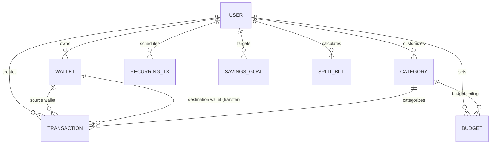

# 🪙 FinTrack Pro — Personal Income & Outcome Tracker
> **A Production-Grade Full-Stack Portfolio Project** built with **Next.js 14 (App Router)**, **TypeScript**, **Tailwind CSS**, **Prisma ORM**, **PostgreSQL / SQLite**, and **NextAuth.js**.

FinTrack Pro adalah aplikasi web pencatat keuangan pribadi modern dan tangguh yang dirancang sesuai standar industri perangkat lunak. Aplikasi ini dilengkapi dengan mekanisme pencegahan kesalahan presisi floating-point, otentikasi aman berbasis JWT/Bcrypt, multi-dompet dengan transfer internal, budgeting dengan alert ambang batas, target tabungan, pelaporan visual yang dapat dicetak (PDF), serta **fitur inovatif berdaya jual tinggi (OCR Struk Belanja, Natural Language AI Input, dan Split Bill Calculator)**.

---

## 🚀 Fitur Unggulan

### 1. Fondasi & Keuangan Inti (MVP)
- **Multi-Dompet & Saldo Terpisah**: Kelola kas fisik (Tunai), rekening bank (BCA, Mandiri), e-wallet (GoPay, OVO, ShopeePay), dan portofolio investasi secara mandiri.
- **Transfer Antar-Dompet Real-time**: Pindahkan saldo antar-dompet secara atomik tanpa tercatat sebagai pengeluaran atau pemasukan baru.
- **Pencatatan Cepat & Multi-Kategori**: Kategori bawaan dan kustom (dengan warna hex & ikon Lucide), catatan singkat, dan lampiran struk belanja.
- **Presisi Uang Aman (Zero Floating-Point Drift)**: Menggunakan utilitas `roundMoney`, `addMoney`, dan `subtractMoney` untuk menjamin kalkulasi nominal selalu akurat (menghindari bug IEEE 754 seperti `0.1 + 0.2 = 0.30000000000000004`).
- **Dashboard Eksekutif**: Total kekayaan bersih (Net Worth), arus kas bulan ini (Income vs Outcome), net cash flow, rasio tabungan (Savings Rate), serta tren 6 bulan terakhir.

### 2. Perencanaan & Kontrol Finansial
- **Anggaran Bulanan (Budgeting)**: Pasang batas kuota pengeluaran per kategori per bulan dengan visual progress bar dan 3 indikator status:
  - 🟢 **Aman** (&lt; 80%)
  - 🟡 **Waspada** (80% - 100%)
  - 🔴 **Overbudget** (&gt; 100%)
- **Transaksi Berulang (Recurring Transactions)**: Jadwalkan pemasukan rutin (gaji) atau tagihan (sewa kos, langganan Netflix/Spotify) harian, mingguan, bulanan, atau tahunan dengan tombol eksekusi manual instan maupun terjadwal.
- **Target Tabungan (Savings Goals)**: Kelola target impian (Dana Darurat, Liburan, Gadget) lengkap dengan persentase progres, sisa hari, dan modal alokasi/pencairan dana yang otomatis memotong dompet terkait.

### 3. Analisis, Laporan & Ekspor/Impor
- **Visualisasi Komposisi Pengeluaran**: Grafik persentase per kategori (mengecualikan transfer internal untuk laporan yang jujur).
- **Tren Historis Multi-Bulan**: Grafik perbandingan pemasukan vs pengeluaran.
- **Cetak & Ekspor PDF**: Tata letak siap cetak (`window.print()`) dengan filter bulan/tahun.
- **Ekspor Excel (.xlsx) & CSV**: Ekspor seluruh riwayat transaksi menggunakan SheetJS (`xlsx`).
- **Impor Transaksi & Mutasi Bank**: Unggah file CSV/Excel dengan pratinjau tabel dan konfirmasi pemetaan sebelum disimpan ke database.

### 4. Fitur Inovatif Portofolio (Showcase)
- 📸 **Scan Struk Belanja Otomatis (OCR)**: Ekstraksi otomatis nominal total belanja, tanggal transaksi, dan nama merchant toko dari struk belanja (lengkap dengan demo preset untuk pengujian instan).
- 🍕 **Kalkulator Split Bill (Patungan)**: Hitung bagi rata (*equal*) atau kustom per item antar teman, kalkulasi pajak (PB1) & service fee, serta tombol satu klik untuk mencatat porsi pribadi ke catatan pengeluaran.
- 🪄 **Natural Language AI Transaction Parser**: Ketik teks bebas dalam Bahasa Indonesia atau Inggris (contoh: *"Beli kopi kenangan 25rb pakai QRIS"*, *"Gaji bulanan 14.5jt masuk BCA"*), dan FinTrack akan otomatis mendeteksi tipe, nominal, kategori, dan dompet.
- 🔒 **PIN Passcode Keamanan**: Kunci PIN 4-6 digit opsional untuk menjaga privasi portofolio keuangan saat aplikasi dibuka.

---

## 🏛️ Arsitektur Folder

```
fintrack/
├── prisma/
│   ├── schema.prisma       # Skema database & relasi tabel
│   ├── seed.ts             # Script seeding data demo komprehensif
│   └── dev.db              # SQLite database (Zero setup local dev)
├── src/
│   ├── app/
│   │   ├── api/            # Route Handlers Next.js App Router
│   │   │   ├── analytics/  # Perhitungan agregasi metrik & tren
│   │   │   ├── auth/       # NextAuth credential login & register
│   │   │   ├── budgets/    # CRUD batas anggaran bulanan
│   │   │   ├── categories/ # CRUD kategori pemasukan/pengeluaran
│   │   │   ├── nlp-parse/  # Parser teks natural language AI
│   │   │   ├── recurring/  # Transaksi berulang & auto-process
│   │   │   ├── savings-goals/ # Target tabungan & deposit/withdraw
│   │   │   ├── split-bill/ # Kalkulator patungan & settlement
│   │   │   ├── transactions/ # Transaksi, filter, dan impor CSV/Excel
│   │   │   ├── user/       # Pengaturan profil, PIN & currency
│   │   │   └── wallets/    # Multi-dompet & mutasi saldo
│   │   ├── analytics/      # Halaman Laporan & Visualisasi Grafik
│   │   ├── budgets/        # Halaman Anggaran Bulanan
│   │   ├── categories/     # Halaman Manajemen Kategori
│   │   ├── goals/          # Halaman Target Tabungan
│   │   ├── import-export/  # Halaman Ekspor Excel/CSV & Impor Mutasi
│   │   ├── login/          # Halaman Masuk & Buat Akun (One-click demo)
│   │   ├── recurring/      # Halaman Transaksi Rutin
│   │   ├── settings/       # Halaman Pengaturan (PIN, Currency, Tema)
│   │   ├── split-bill/     # Halaman Kalkulator Split Bill
│   │   ├── transactions/   # Halaman Riwayat Transaksi & Filter
│   │   ├── globals.css     # Tailwind styling & dark mode setup
│   │   ├── layout.tsx      # Root Layout dengan Provider & PIN Modal
│   │   └── page.tsx        # Dashboard Utama FinTrack
│   ├── components/
│   │   ├── AppLayout.tsx   # Sidebar & Navbar container
│   │   ├── DynamicIcon.tsx # Dynamic Lucide-react icon resolver
│   │   ├── Navbar.tsx      # Header bar, tema & notifikasi
│   │   ├── PinLockModal.tsx# Kunci PIN passcode modal
│   │   ├── QuickTransactionModal.tsx # Form catat cepat + OCR + AI
│   │   ├── SessionProvider.tsx # NextAuth provider
│   │   ├── Sidebar.tsx     # Navigasi utama responsif
│   │   └── ThemeProvider.tsx # Next-themes dark/light wrapper
│   └── lib/
│       ├── auth.ts         # Konfigurasi NextAuth Options & JWT
│       ├── money.ts        # Presisi uang aman & konversi kurs
│       ├── nlp.ts          # Algoritma heuristik ekstraksi bahasa alami
│       ├── ocr.ts          # Ekstraksi struk belanja OCR & preset
│       ├── prisma.ts       # Prisma Client Singleton
│       └── validations.ts  # Skema validasi Zod ketat
├── package.json
├── tailwind.config.js
└── tsconfig.json
```

---

## 🗄️ Skema Database & Relasi (Prisma)

Skema database FinTrack Pro dirancang untuk mendukung integritas relasional penuh dengan PostgreSQL di lingkungan produksi dan SQLite di lingkungan pengembangan lokal:



### Penjelasan Model Utama
1. **User**: Menyimpan identitas, email unik, password terenkripsi bcrypt, preferensi mata uang (`IDR`, `USD`, `SGD`), dan kode PIN opsional.
2. **Wallet**: Mewakili dompet tunai, rekening bank, e-wallet, atau akun investasi dengan pencatatan saldo berjalan (*running balance*).
3. **Category**: Kategori berlabel tipe `INCOME` atau `EXPENSE`, warna hex kustom, dan nama ikon.
4. **Transaction**: Transaksi tipe `INCOME`, `EXPENSE`, atau `TRANSFER`. Pada transfer internal, `walletId` mencatat sumber dana dan `destinationWalletId` mencatat tujuan dana.
5. **Budget**: Memetakan kuota batas pengeluaran bulanan unik per `(userId, categoryId, month, year)`.
6. **RecurringTransaction**: Jadwal eksekusi otomatis dengan interval frekuensi dan penanda `lastRunDate` & `nextRunDate`.
7. **SavingsGoal**: Target impian dengan akumulasi dana `currentAmount`, `targetAmount`, dan tanggal target.
8. **SplitBill**: Menyimpan total tagihan, jumlah orang, dan porsi tanggungan pribadi (`myShare`).

---

## 🧮 Alur Perhitungan Saldo & Laporan (Keamanan Transaksional)

### 1. Saldo Dompet & Integritas ACID
Setiap pembuatan, pengubahan, atau penghapusan transaksi dieksekusi di dalam **Prisma Interactive Transaction (`prisma.$transaction`)**:
- **INCOME**: Menambahkan nominal ke dompet sumber (`balance = balance + amount`).
- **EXPENSE**: Mengurangi nominal dari dompet sumber (`balance = balance - amount`).
- **TRANSFER**: Mengurangi saldo dompet sumber dan menambahkan nominal ke dompet tujuan secara atomik.
- **Rollback Transaksi**: Saat transaksi diperbarui atau dihapus, dampak saldo sebelumnya dibalikkan (*reverted*) terlebih dahulu sebelum dampak baru diterapkan.

### 2. Pencegahan Floating-Point Bug
Semua operasi aritmatika uang menggunakan pembungkus presisi di `src/lib/money.ts`:
```typescript
export function roundMoney(amount: number): number {
  return Math.round((amount + Number.EPSILON) * 100) / 100;
}
```

### 3. Pemisahan Transfer dari Laporan Pengeluaran
Dalam pelaporan bulanan (`/api/analytics`), transaksi bertipe `TRANSFER` tidak dihitung sebagai pengeluaran maupun pemasukan, melainkan pergerakan aset internal murni, sehingga tidak mendistorsi rasio tabungan (*Savings Rate*) pengguna.

---

## 🔑 Kredensial Demo Portofolio (Siap Uji)

Aplikasi telah dilengkapi dengan data seed lengkap:
- **Email Demo**: `demo@fintrack.app`
- **Password**: `password123`
- **PIN Keamanan (Opsional)**: `1234`
- **Fitur 1-Klik**: Pada halaman `/login`, klik tombol **"Masuk 1-Klik sebagai Demo User"** untuk langsung mendemokan aplikasi tanpa mengetik.

---

## 💻 Panduan Instalasi & Menjalankan Lokal

```bash
# 1. Masuk ke direktori project
cd fintrack

# 2. Sinkronkan skema database & generate client
npm run prisma:push

# 3. Jalankan seed data contoh (15 transaksi, 4 dompet, budgeting, target, split bill)
npm run prisma:seed

# 4. Jalankan server pengembang
npm run dev
```
Buka browser di **`http://localhost:3000`**.
